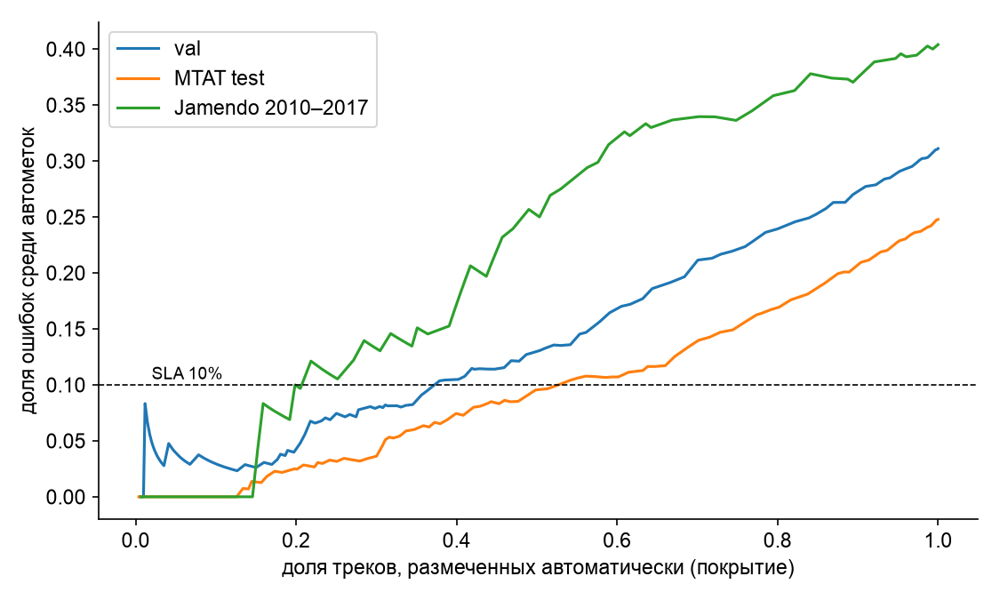

## 4. Экспериментальные результаты

### 4.1 Сводная таблица ЛР1–4

| Этап | Лучшее решение | Результат [95% ДИ] | Отрицательные результаты | Место в системе |
|---|---|---|---|---|
| ЛР1. LLM / VLM по спектрограмме | Gemma-3-4B, few-shot | Macro-F1 0,241 [0,195; 0,284] (200 клипов); 0,213 на 1 009 | все 3 VLM на уровне угадывания (0,10–0,24); уверенность всегда 0,8–0,95 (ECE 0,53–0,71); инструментал узнан в 1 из 350 | модуль исключён из решений; обученный baseline LogReg 0,746 [0,684; 0,803] |
| ЛР2. Мультимодальность | стекинг (текст + ряд + спектрограмма) | Macro-F1 0,760 (тест 1 009); прирост +0,079 [+0,007; +0,131], p = 0,0002 | ранняя fusion без прироста (+0,007, p = 0,40); Gated-MLP хуже одномодальной (−0,077); CLIP zero-shot 0,229; на Jamendo прирост исчезает (поздняя fusion 0,424 против 0,437 у спектрограммы, p = 0,59) | мультимодальный модуль: поздняя fusion — устойчива к пропуску модальности; в системе среднее с равными весами (0,748 на тесте; веса по val из ЛР2 — 0,723, +0,043 [+0,018; +0,079]) |
| ЛР3. Многоагентная маршрутизация | MAPPO (лучший из 8 MARL) | ценность 2,79 [2,20; 3,37] за 50 треков | все 8 MARL хуже правила «равные веса» (8,58) и PPO (8,50), 0 из 5 seed; COMA выродился; SLA ≤ 10% ошибок нарушен у всех политик | маршрутизация — централизованное правило; MARL — экспериментальная ветка |
| ЛР4. Оптимизация | Nesterov (сводный балл 0,711) | test Macro-F1 0,682 [0,676; 0,688] | лидеры статистически неразличимы (Holm); при переносе в модель ЛР2 Nesterov один из худших (0,602 против 0,648 у Adam) | оптимизатор подбирается под архитектуру |

### 4.2 Итоговая система: качество маршрутизации («покрытие — ошибка»)

Порог τ подбирается на val под заданный уровень ошибок автометок (SLA) и проверяется на отложенных данных.

| Требование (ошибка автометок ≤) | τ (val) | MTAT test: покрытие / ошибка | Jamendo 2010–2017: покрытие / ошибка |
|---|---|---|---|
| 20% | 0,435 | 77,4% / 16,3% ✔ | 64,2% / 33,0% ✘ |
| **10%** | **0,575** | **43,9% / 8,4% ✔** | 35,8% / 14,8% ✘ |
| 5% | 0,695 | 24,5% / 3,2% ✔ | 21,9% / 12,1% ✘ |
| правило ЛР3 (τ = 0,425) | 0,425 | 79,3% / 16,7% | 70,2% / 34,0% |
| единогласие трёх экспертов | — | 37,7% / 6,6% | 29,1% / 20,5% |

**Вывод.** На каталоге, похожем на обучающий, система выполняет SLA 10%, размечая автоматически 44% треков. На новом каталоге тот же порог даёт 15% ошибок: SLA нарушен при любом пороге из таблицы. Перед развёртыванием на новом каталоге **обязательна перекалибровка** на размеченной выборке этого каталога.

### 4.3 Абляции (сводно)

| Что удалено / изменено | Эффект | Источник |
|---|---|---|
| временной ряд из ранней fusion | 0,687 → 0,613 (основная модальность) | ЛР2 |
| текст из ранней fusion | 0,687 → **0,710** (сжатый текст мешает) | ЛР2 |
| пропуск модальности при тесте, поздняя fusion | падение ≤ 0,05 | ЛР2 |
| пропуск ряда, Gated-MLP | 0,604 → 0,407 | ЛР2 |
| гармонизация частоты дискретизации на Jamendo | ряд 0,222 → 0,362; поздняя fusion 0,237 → 0,424 | ЛР2 |
| координатор в MARL | test 2,79 → 2,25; на Jamendo без координатора **лучше** (−12,8 против −15,7) | ЛР3 |
| воздержание экспертов / репутация | −0,2 / −0,6 на test, в пределах разброса | ЛР3 |
| weight decay 10⁻³ | +0,019…+0,025 Macro-F1 у всех проверенных оптимизаторов | ЛР4 |
| lr × 3 от оптимума | −0,06…−0,14 | ЛР4 |
| few-shot вместо zero-shot (VLM) | +0,04…+0,08, но остаётся угадывание | ЛР1 |

### 4.4 Анализ ошибок

1. **Путаница женского и мужского вокала** — главная ошибка аудио-модальностей (женский → мужской: 65 случаев у ряда). Стекинг сокращает её до 26 за счёт текста (имена исполнителей) и спектрограммы.
2. **Инструментал → вокал.** «Поющие» инструменты (флейта, струнные) принимаются за голос: instrumental → female — 48 ошибок у стекинга. VLM в ЛР1 почти никогда не выбирали инструментал.
3. **Хор → женский вокал.** Высокие голоса детских и церковных хоров.
4. **Согласие модальностей — индикатор надёжности:** при единогласии точность 93% на 38% треков, при полном несогласии — 44%.
5. **Перенос:** на Jamendo класс group не распознаётся ни одной моделью (шумная метка), текст не переносится (0,17).
6. **Шум разметки:** разные сегменты одного трека размечены по-разному (Norine Braun, «Little Lamb»); единодушно «инструментальный» клип с тегом female (Minstrel Spirit).

### 4.5 Неудачные и вырожденные запуски (не скрываются)

| ЛР | Запуск | Что произошло |
|---|---|---|
| 1 | Qwen2.5-VL-3B / 7B zero-shot | ответ константой (100% «male» / 98% «female») |
| 1 | Gemma zero-shot | 3 невалидных ответа: рассуждение не уложилось в лимит токенов |
| 1 | Gemini API, GigaChat, Qwen-32B | не запущены: регион, авторизация, скорость сети |
| 2 | первый перенос на Jamendo без гармонизации | ряд и fusion развалились (Brier 1,18); причина найдена и исправлена |
| 2 | Gated-MLP | выродился в модель одного ряда (вес изображения 0,03–0,05) |
| 3 | COMA, все 5 seed | эксперты всегда воздерживаются; −25 или −58,5 ценности, нарушения бюджета 28% |
| 3 | MADDPG | отрицательная ценность (−1,85), просадка −541 |
| 4 | подбор lr: 4 оптимизатора на краю сетки | сетка расширена по общему правилу, оптимумы подтверждены |
| 4 | все 436 запусков | расходимостей нет; ранний всплеск loss у SGD+Momentum / Nesterov при lr 0,3 |

### 4.6 Демонстрационный сценарий (`src/demo.py`, журнал — `results/demo_log.jsonl`)

Поток из 8 треков: 6 с теста MTAT (исполнители не встречались в обучении) и 2 из Jamendo. Бюджет модерации — 3.

| Трек | Истина | Голоса: текст / ряд / изображение | Согласие | Метка | Уверенность | Решение |
|---|---|---|---|---|---|---|
| Norine Braun — Modern Anguish | female | female / male / female | 2 из 3 | female | 0,447 | автометка ✔ |
| Psychetropic — Futurengine | instrumental | instrumental / group / instrumental | 2 из 3 | instrumental | 0,547 | автометка ✔ |
| St. Eliyah Childrens Choir — Blessed is the man | group | group / group / group | 3 из 3 | group | 0,763 | автометка ✔ |
| Tilopa — Roku | instrumental | female / instrumental / instrumental | 2 из 3 | instrumental | 0,640 | автометка ✔ |
| Processor — Insomnia | male | instrumental / instrumental / male | 2 из 3 | instrumental | 0,451 | автометка ✘ (ошибка) |
| Norine Braun — Climb the Mountain | female | male / female / female | 2 из 3 | female | 0,495 | автометка ✔ |
| WEXIN — Seven Days (Jamendo) | instrumental | male / instrumental / instrumental | 2 из 3 | instrumental | 0,607 | автометка ✔ |
| The Poetize Code — Flowers… (Jamendo) | female | male / female / instrumental | 1 из 3 | female | 0,387 | **модератор** + предупреждение о несогласии |

Время обработки — около 0,08 с на трек (первый трек — 1,1 с на прогрев). Сценарий показывает обе стороны системы:
- **объяснимые верные решения** — голоса модальностей видны модератору;
- **реальный риск:** «Insomnia» уверенно размечен ошибочно при пороге ЛР3 (0,425). При пороге под SLA 10% (0,575) этот трек и ещё 3 трека с уверенностью ниже 0,575 тоже ушли бы модератору, и ошибка не попала бы в каталог.
